# CFD 科研绘图 skill 系统测试

## 结论与范围

完成 5 张 line、5 张 point-line、2 张混合补充图和 4 张其他图，共 16 张。
所有 line 数据系列均无标记；所有 point-line 数据系列均有标记且连线。混合图不冒充 point-line。
真实 DNS 来源为首选 Kawamura Lab；NASA 备用源未启用。合成 CFD/测量/残差均明确标注，不能用来声称物理模型获得验证。
所有图为双栏 183 × 136 mm、300 dpi、仅 PNG；原始数据未平滑或抽稀。

## 数据溯源

数据库主页：https://www.rs.tus.ac.jp/~t2lab/db/poi/poi.html

原始文件保留作者署名、引用要求和使用说明；数据不是本项目原创，也不假定为无条件开放许可。

Re_tau=u_tau*h/nu，Re_bulk=Ub*2h/nu；u+=u/u_tau，y+=y*u_tau/nu；h 为半通道高度。

- `Poi180_4th_E.dat`：Re_tau=180，Re_bulk=5665，240 个原始位置；https://www.rs.tus.ac.jp/~t2lab/db/poi/text/Poi180_4th_E.dat
  SHA256：`8bbf90c850d7dc525e83f3d7b346707d45ce8f5fad889976e720b2ddfcdcb36c`
- `Poi395_4th_D.dat`：Re_tau=395，Re_bulk=14124，240 个原始位置；https://www.rs.tus.ac.jp/~t2lab/db/poi/text/Poi395_4th_D.dat
  SHA256：`b89a0cede344a0e4f5fa6d33d923939af08f1d1d4b0336a11c24891d10c414d1`
- `Poi640_4th_B.dat`：Re_tau=640，Re_bulk=24428，128 个原始位置；https://www.rs.tus.ac.jp/~t2lab/db/poi/text/Poi640_4th_B.dat
  SHA256：`a5e045ce4952dd26c15cc924e39365af98f6ec5a5f0f5b55ea636f02d87c029f`
- `Poi1020_4th_A_ver2.dat`：Re_tau=1020，Re_bulk=41441，224 个原始位置；https://www.rs.tus.ac.jp/~t2lab/db/poi/text/Poi1020_4th_A_ver2.dat
  SHA256：`a5b8251fdc8d5bc53b955ecfb79428bda72898cd33ebd030971d7f3f6a4fef04`
- `Poi180_2nd_A.dat`：Re_tau=180，Re_bulk=5692，33 个原始位置；https://www.rs.tus.ac.jp/~t2lab/db/poi/text/Poi180_2nd_A.dat
  SHA256：`82f1b30ac351394b054d12a1c89f24c809cbdcae75d2d5c5fa9ff817436c217c`

引用应按原文件的 References 节选择，尤其注意不同 Reynolds 数与数据版本的出处不同。

## 逐图记录（按执行顺序）

### A01_line_residual — line

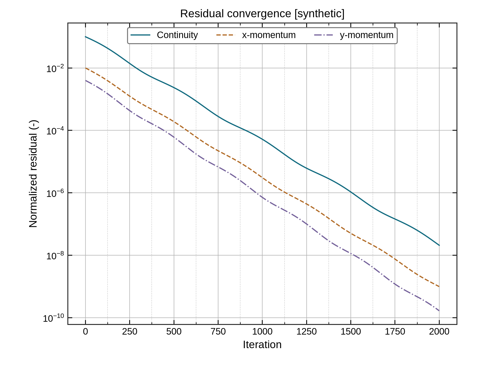

- 数据来源：人为构造的残差序列，不是求解器输出。
- 物理含义：连续性和两个动量方程的归一化残差，测试跨数量级收敛。
- 关键参数：迭代 0–2000，步长 1；R=A*10^(-n/tau)*(1+a*sin(n/b))；纵轴 log。
- CSV：`data/A01_line_residual.csv`；数据行数：6003。
- 自动检查：all source points retained；within-series row order preserved；line/marker semantics correct；four inward-ticked sides；labels/legend inside canvas；no sampled data covered by legend；183 x 136 mm; double-column font sizes。

### A02_line_dns_inner — line

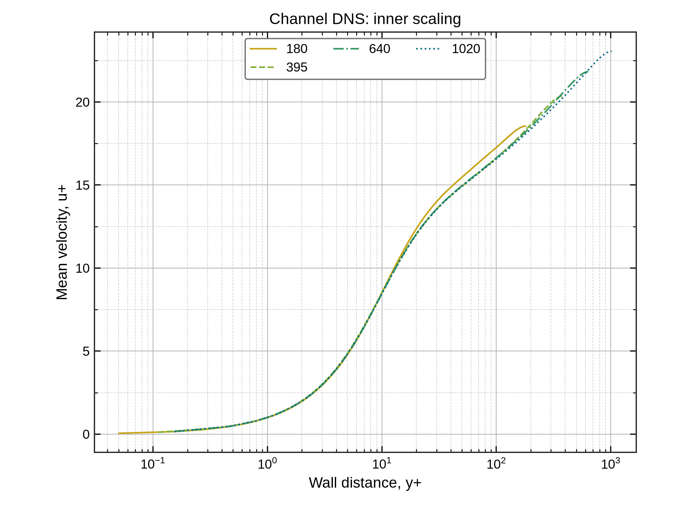

- 数据来源：Kawamura Lab：Poi180_4th_E.dat, Poi395_4th_D.dat, Poi640_4th_B.dat, Poi1020_4th_A_ver2.dat
- 物理含义：充分发展湍流平面通道流的半通道均值速度内尺度剖面。
- 关键参数：Re_tau=180/395/640/1020；原始全部测点；横轴 log，y+>0，无补壁面点。
- CSV：`data/A02_line_dns_inner.csv`；数据行数：832。
- 自动检查：all source points retained；within-series row order preserved；line/marker semantics correct；four inward-ticked sides；labels/legend inside canvas；no sampled data covered by legend；183 x 136 mm; double-column font sizes。

### A03_line_pipe — line

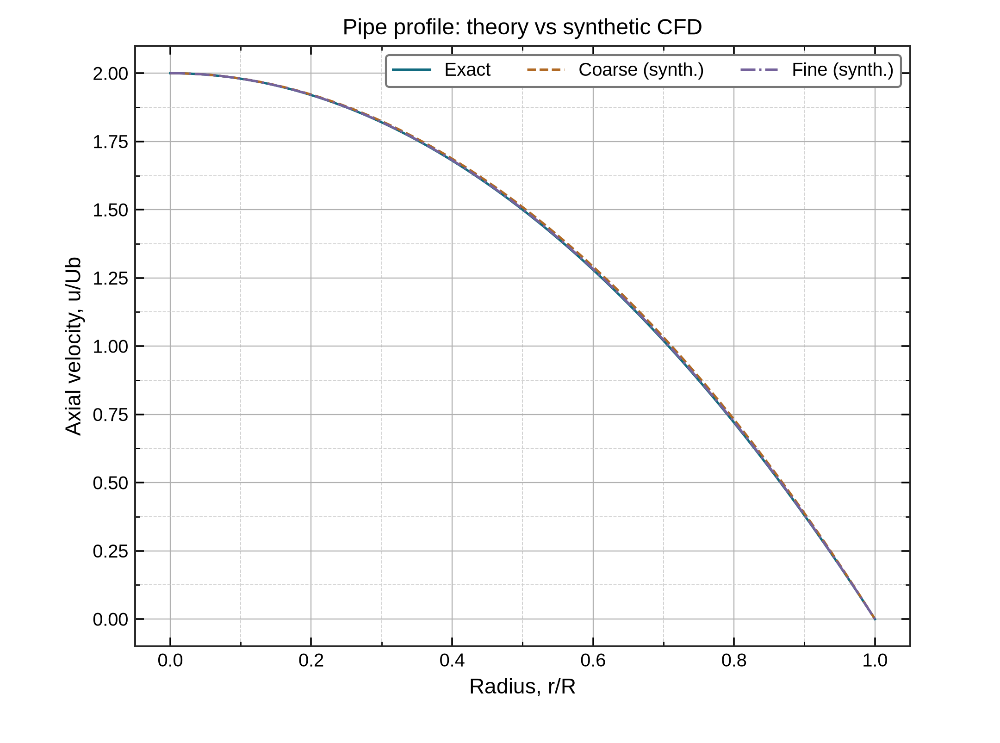

- 数据来源：Hagen–Poiseuille 解析解 + 明确构造的两组数值示意结果。
- 物理含义：不可压缩、充分发展层流圆管轴向速度；不是湍流平面通道的解析解。
- 关键参数：Re_D=1000；u/Ub=2[1-(r/R)^2]；偏差乘子 1+0.025(r/R)^2 和 1+0.00625(r/R)^2。
- CSV：`data/A03_line_pipe.csv`；数据行数：603。
- 自动检查：all source points retained；within-series row order preserved；line/marker semantics correct；four inward-ticked sides；labels/legend inside canvas；no sampled data covered by legend；183 x 136 mm; double-column font sizes。

### A04_line_blasius — line

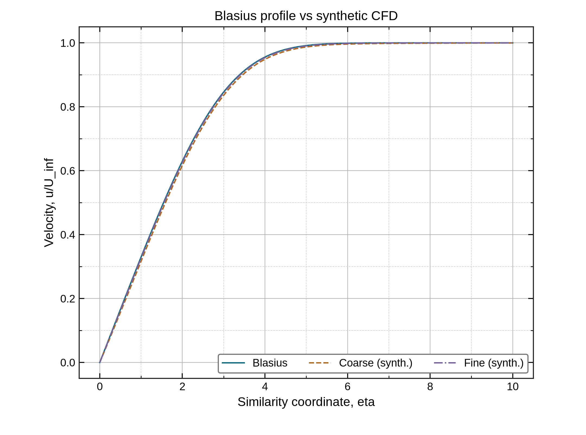

- 数据来源：Blasius 相似性方程数值求解的理论参考曲线 + 合成数值偏差。
- 物理含义：零压梯度层流平板边界层；Blasius 没有在此被冒称为闭式解析公式。
- 关键参数：f'''+0.5*f*f''=0；f(0)=f'(0)=0，f'(10)=1；RK4+二分打靶，deta=0.01；f''(0)=0.3320573372。
- CSV：`data/A04_line_blasius.csv`；数据行数：3003。
- 自动检查：all source points retained；within-series row order preserved；line/marker semantics correct；four inward-ticked sides；labels/legend inside canvas；no sampled data covered by legend；183 x 136 mm; double-column font sizes。

### A05_line_dns_stresses — line

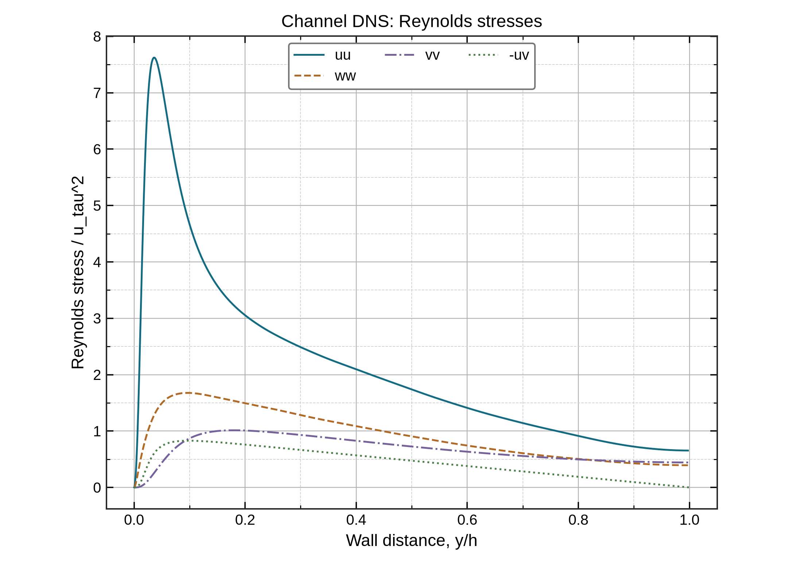

- 数据来源：Kawamura Lab：Poi395_4th_D.dat 的均值表与剪切应力表。
- 物理含义：三个法向雷诺应力及负雷诺剪切应力；不是速度 RMS。
- 关键参数：Re_tau=395；均值/uu/ww 与 vv/-uv 是交错网格，分别保留各表原始 y+；y/h=y+/Re_tau；不插值合并。
- CSV：`data/A05_line_dns_stresses.csv`；数据行数：960。
- 自动检查：all source points retained；within-series row order preserved；line/marker semantics correct；four inward-ticked sides；labels/legend inside canvas；no sampled data covered by legend；183 x 136 mm; double-column font sizes。

### B01_pointline_lift — point-line

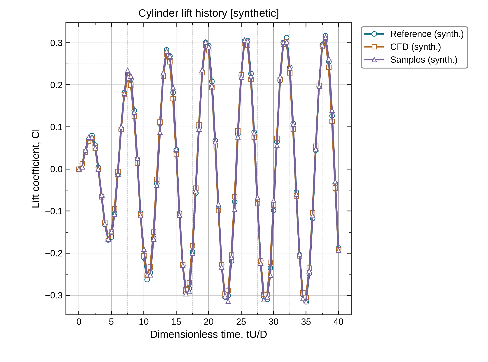

- 数据来源：合成圆柱涡脱落式时间信号；包括合成参考和合成测量点，无真实实验。
- 物理含义：启动后趋于周期振荡的升力时间历程。所有组均同时画点和连线。
- 关键参数：示意 Re_D=100；St=0.165；tU/D=0–40，dt=0.5；噪声标准差 0.007；seed=20261019。
- CSV：`data/B01_pointline_lift.csv`；数据行数：243。
- 自动检查：all source points retained；within-series row order preserved；line/marker semantics correct；four inward-ticked sides；labels/legend inside canvas；no sampled data covered by legend；183 x 136 mm; double-column font sizes。

### B02_pointline_dns_schemes — point-line

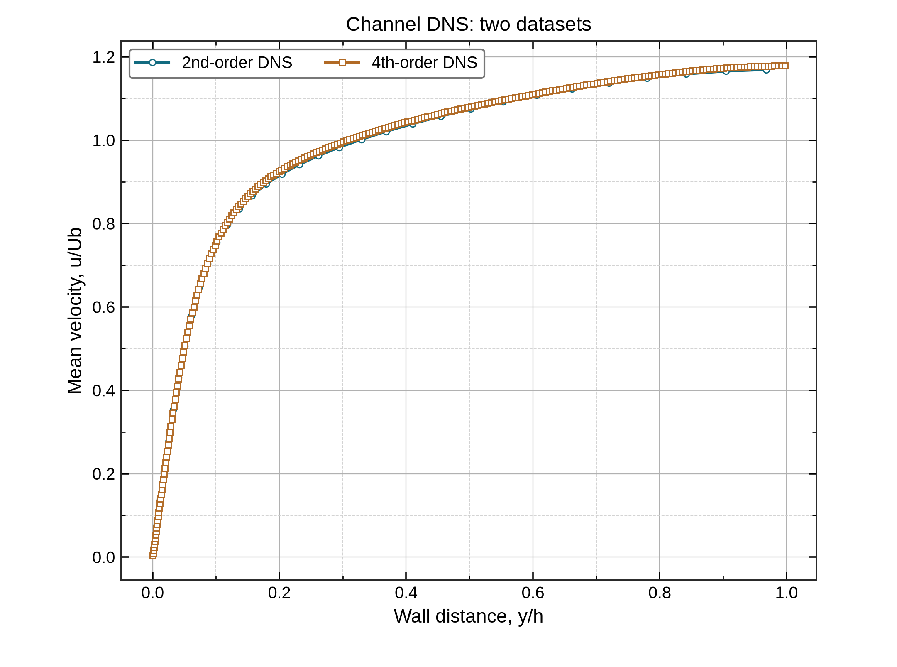

- 数据来源：Kawamura Lab：Poi180_2nd_A.dat、Poi180_4th_E.dat，均为真实 DNS。
- 物理含义：不同分辨率及离散方法数据的空间剖面对比；不能据此单独归因于离散阶数。
- 关键参数：Re_tau=180；Re_bulk=5692/5665；Ub+=Re_bulk/(2*Re_tau)；保留两套原网格，不插值对齐。
- CSV：`data/B02_pointline_dns_schemes.csv`；数据行数：273。
- 自动检查：all source points retained；within-series row order preserved；line/marker semantics correct；four inward-ticked sides；labels/legend inside canvas；no sampled data covered by legend；183 x 136 mm; double-column font sizes。

### B03_pointline_dns_reynolds — point-line

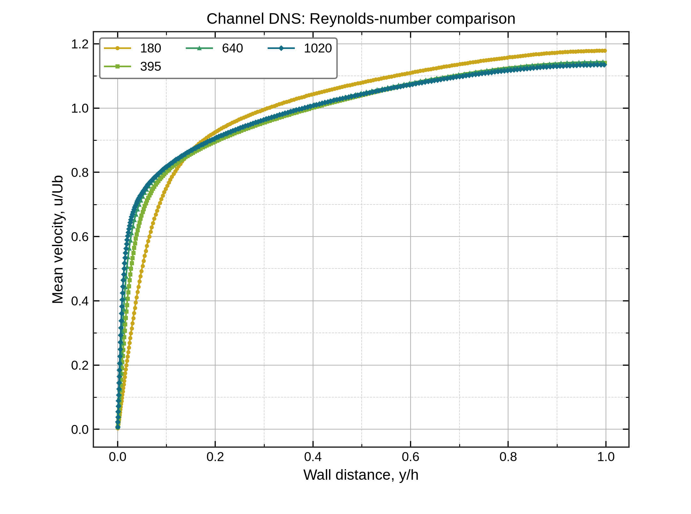

- 数据来源：Kawamura Lab：四组原始 DNS 均值剖面。
- 物理含义：不同摩擦雷诺数下的外尺度均值速度，检验有序配色和密集非均匀网格标记。
- 关键参数：Re_tau=180/395/640/1020；y/h=y+/Re_tau；u/Ub=u+/(Re_bulk/(2*Re_tau))；全部原始点。
- CSV：`data/B03_pointline_dns_reynolds.csv`；数据行数：832。
- 自动检查：all source points retained；within-series row order preserved；line/marker semantics correct；four inward-ticked sides；labels/legend inside canvas；no sampled data covered by legend；183 x 136 mm; double-column font sizes。

### B04_pointline_pipe — point-line

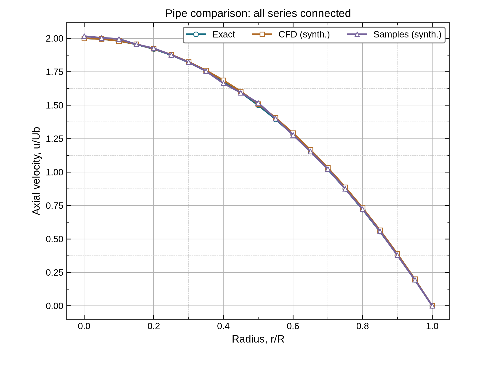

- 数据来源：Hagen–Poiseuille 解析解 + 合成 CFD 和合成测量点。
- 物理含义：同图对比理论、数值示意和测量示意；按 point-line 定义，三组都显示点和连线。
- 关键参数：Re_D=1000；21 个 r/R 位置；u/Ub=2[1-(r/R)^2]；噪声为 0.012*(1-r^2)；固定种子。
- CSV：`data/B04_pointline_pipe.csv`；数据行数：63。
- 自动检查：all source points retained；within-series row order preserved；line/marker semantics correct；four inward-ticked sides；labels/legend inside canvas；no sampled data covered by legend；183 x 136 mm; double-column font sizes。

### B05_pointline_blasius — point-line

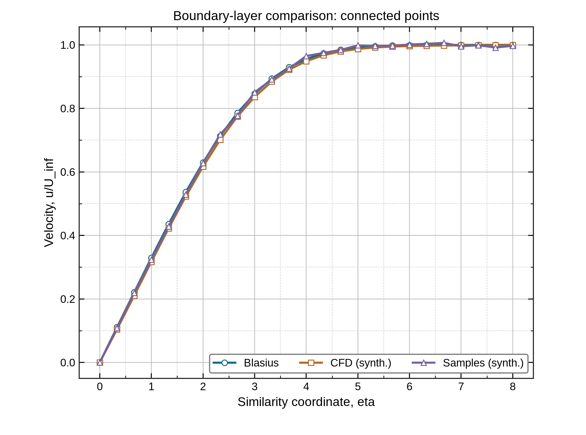

- 数据来源：A04 的 Blasius 理论解显式线性插值到 25 个位置 + 合成 CFD 和合成测量点。
- 物理含义：边界层速度剖面的三组点线比较；插值仅用于构造理论采样，不修改 DNS。
- 关键参数：eta=0–8，共 25 点；数值偏差 -0.025*eta*exp(-eta/1.5)；合成测量噪声标准差上限 0.005。
- CSV：`data/B05_pointline_blasius.csv`；数据行数：75。
- 自动检查：all source points retained；within-series row order preserved；line/marker semantics correct；four inward-ticked sides；labels/legend inside canvas；no sampled data covered by legend；183 x 136 mm; double-column font sizes。

### B06_mixed_pipe — mixed

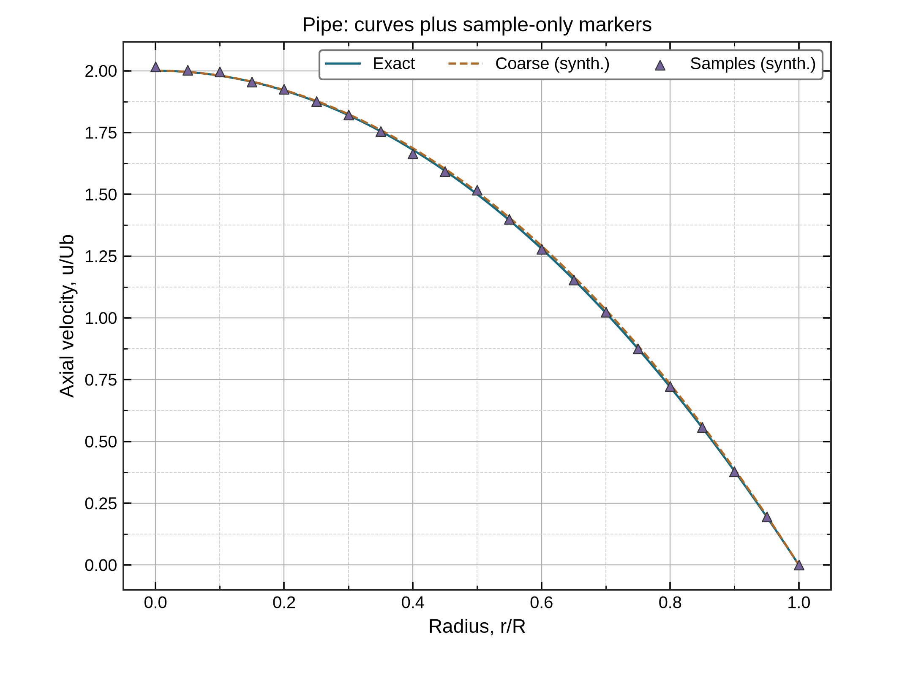

- 数据来源：同 A03/B04；测量点仍为合成数据。
- 物理含义：理论线 + 数值线 + 不连线的合成测量点。
- 关键参数：Python API 返回 Axes 后叠加 scatter；不是原生 point-line 模式；复用母板配色、图例和布局检查。
- CSV：`data/B06_mixed_pipe.csv`；数据行数：402。
- 自动检查：all source points retained；within-series row order preserved；line/marker semantics correct；scatter offsets exact; no added connections；four inward-ticked sides；labels/legend inside canvas；no sampled data covered by legend；183 x 136 mm; double-column font sizes。

### B07_mixed_blasius — mixed

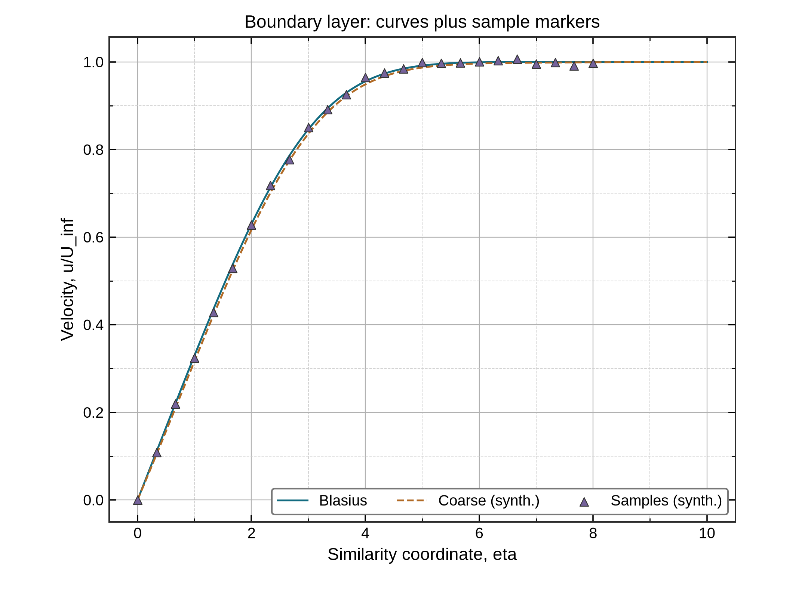

- 数据来源：同 A04/B05；测量点仍为合成数据。
- 物理含义：Blasius 理论线 + 数值线 + 不连线的合成测量点。
- 关键参数：Python API 返回 Axes 后叠加 scatter；不是原生 point-line 模式；复用母板配色、图例和布局检查。
- CSV：`data/B07_mixed_blasius.csv`；数据行数：2002。
- 自动检查：all source points retained；within-series row order preserved；line/marker semantics correct；scatter offsets exact; no added connections；four inward-ticked sides；labels/legend inside canvas；no sampled data covered by legend；183 x 136 mm; double-column font sizes。

### C01_scatter — scatter

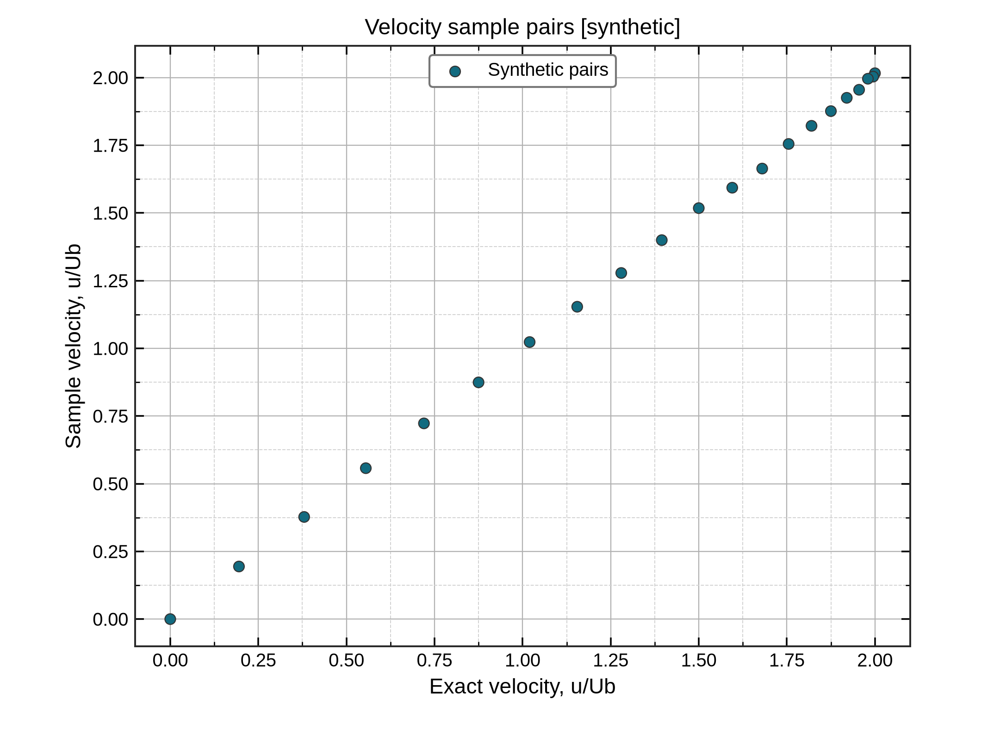

- 数据来源：B04 的理论值与合成观测值逐点配对。
- 物理含义：最简单的一组散点，无连接线。
- 关键参数：21 对数据，无拟合、无回归线。
- CSV：`data/C01_scatter.csv`；数据行数：21。
- 自动检查：scatter offsets exact; no added connections；four inward-ticked sides；labels/legend inside canvas；no sampled data covered by legend；183 x 136 mm; double-column font sizes。

### C02_bar — bar

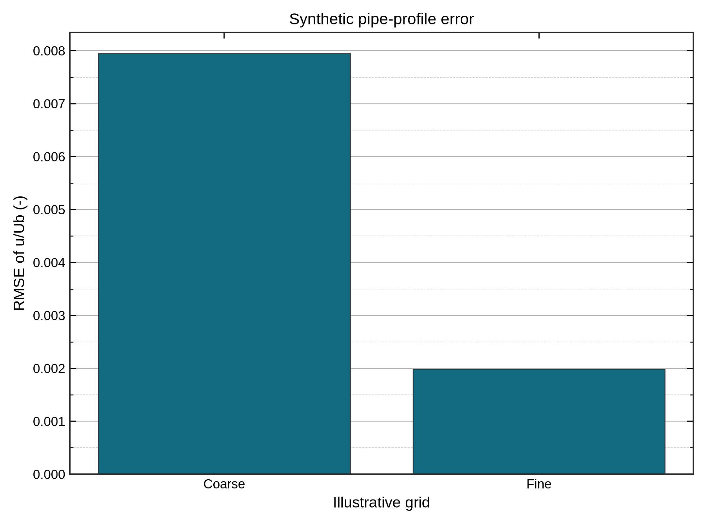

- 数据来源：显式从 A03 的合成剖面计算 RMSE；并非真实网格收敛研究。
- 物理含义：两个预先计算的误差数值。
- 关键参数：RMSE=sqrt(mean((u_synth-u_exact)^2))；201 个 r/R 等距采样点。
- CSV：`data/C02_bar.csv`；数据行数：2。
- 自动检查：precomputed bar heights preserved；four inward-ticked sides；labels/legend inside canvas；no sampled data covered by legend；183 x 136 mm; double-column font sizes。

### C03_heatmap — heatmap

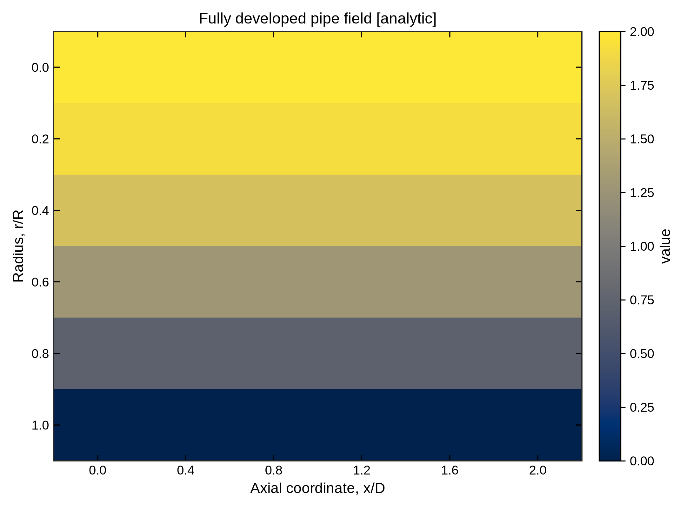

- 数据来源：Hagen–Poiseuille 解析速度场，规则网格显式求值。
- 物理含义：充分发展时速度沿轴向不变、沿径向抛物分布。
- 关键参数：6x6 网格；value=u/Ub=2[1-(r/R)^2]；cividis；原生 imshow 将首行放在图像上方。
- CSV：`data/C03_heatmap.csv`；数据行数：36。
- 自动检查：heatmap cells preserved；four inward-ticked sides；labels/legend inside canvas；no sampled data covered by legend；183 x 136 mm; double-column font sizes。

### C04_violin — violin

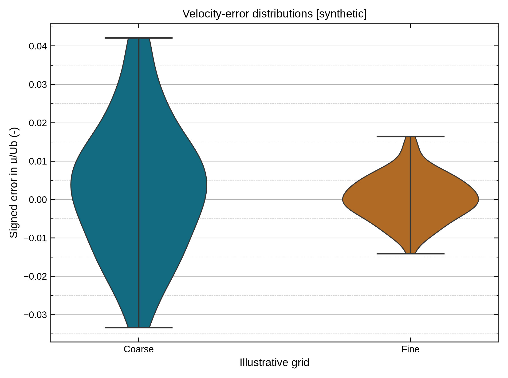

- 数据来源：独立构造的高斯误差样本，不是从 DNS 计算的误差，也不是 A03 的误差分布。
- 物理含义：两组原始样本的核密度形状。
- 关键参数：每组 80 点；均值 0，标准差 0.018/0.006；固定种子；小提琴轮廓是模板内置 KDE。
- CSV：`data/C04_violin.csv`；数据行数：160。
- 自动检查：two violin bodies plus extrema artists；four inward-ticked sides；labels/legend inside canvas；no sampled data covered by legend；183 x 136 mm; double-column font sizes。

## 发现的问题和使用边界

1. 环境未安装 Arial，模板按既定规范警告后回退到 Liberation Sans；没有悄悄换风格。
2. CLI/API 没有 xscale/yscale 参数。A01 的 log-y 和 A02 的 log-x 通过返回的 Axes 显式设置，同时将 AutoMinorLocator 换为 LogLocator，并重算线宽、图例和边界网格；未修改母板。
3. 原生 kind 是整图级别，不能直接按系列混用 line/scatter。B06/B07 是 Python API 叠图示范，理论/数值为纯线，合成测量为纯散点，复用母板的布局检查。B01–B05 则严格所有系列都点+线。
4. point-line 前 8 组以点形区分，连接线默认同为实线；line 前 8 组使用不同线型。因此多 Re 黑白打印主要依赖点形，不能声称每组自动获得不同线型。
5. 密集 DNS 点线图保留全部点，自动降低到 2.4–3.5 pt 标记；近壁点仍可能拥挤。双栏尺寸可读，不能把双栏图直接缩到单栏使用。
6. 两套 Re_tau=180 DNS 的网格和空间离散同时不同；比较不构成控制变量下的阶数验证。
7. 热力图原生首行在上方，本例径向标签随之从上到下增大；没有暗中改变坐标方向。
8. 小提琴图原生使用 KDE，是分布可视化而非无处理的折线；未额外进行数据平滑。
9. 数据下载时 Re_tau=1020 文件曾出现 TLS EOF，重试后成功；原始文件和校验和已缓存，复现不需要联网。

10. DNS 的均值/uu/ww 表和 vv/-uv 表位于交错网格。不能按相同 j 直接共用 y+；A05 分别使用两表自身的坐标，未进行空间插值。

11. 实测发现并修复原生长表热力图缺陷：render_plot 校验线宽/点径时的局部变量 value 覆盖了热力图的 value 列名。将局部变量改名 override；新增 API 与 CLI 回归测试。该修复不改变绘图风格，输出母板快照包含此修复。

12. 全范围理论/合成数值剖面高度重合，是有意设置的小偏差，不是漏画。如用于量化方法差异，应另加误差剖面或局部放大；本轮不额外修改既定单图样式。

## 复现与审计

- `manifest.json`：原始 URL/校验和、参数、逐图检查、警告和环境版本。
- `data/`：每图准确输入 CSV，混合图另存 overlay CSV。
- `raw/`：下载文件及数据库页面快照；保留来源与作者说明。
- `plot_template_snapshot.py`：本次绘图母板副本，SHA256 记录于 manifest。
- `cfd_runner.py` 和 `reproduce.py`：离线重绘，使用同目录母板和 CSV，不依赖仓库原路径。
- 在本目录运行 `python reproduce.py`；需要 numpy/pandas/matplotlib/Pillow，完整版本见 manifest。
- 自动审计检查 artist 数据、系列顺序、标记/连线语义、四边朝内刻度、图例与文本边界、图例覆盖采样检查及 PNG 像素尺寸。视觉复核不能由这些断言完全替代。
